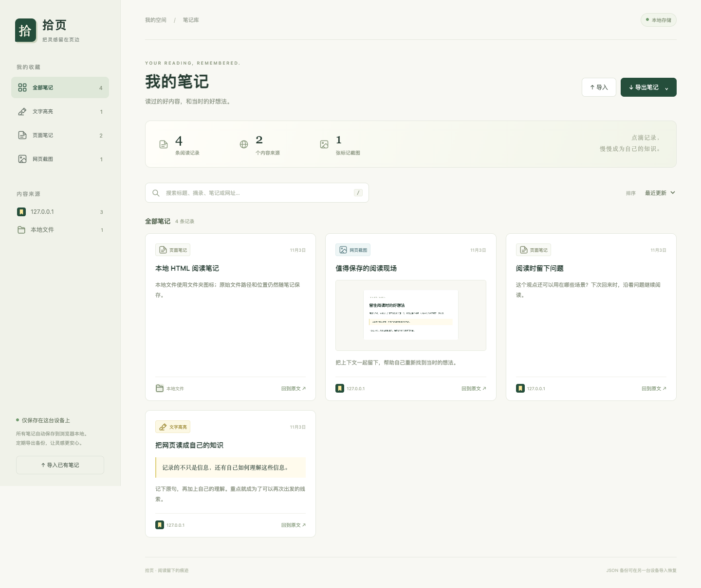

# 拾页 · 网页高亮与笔记

[MIT 许可证](LICENSE) · [隐私政策](PRIVACY.md) · [贡献指南](CONTRIBUTING.md) · [发布说明](docs/PUBLISHING.md)

给阅读中的重点加上高亮、旁注和截图标记，保留原文 URL 与位置。适用于桌面 Chrome / Edge 的 Manifest V3 扩展；支持在线网页和本机 HTML。原生 JavaScript，无运行依赖、无账号、无服务端。



## 安装（不需要 npm 或构建）

从 [GitHub Releases](https://github.com/blacker521/shiye-web-notes/releases) 下载 `shiye-extension-v1.0.0.zip`（精简插件）或 `shiye-web-notes-v1.0.0.zip`（完整源码），解压后按下列步骤加载。当前使用开发者模式安装，尚未在 Chrome 商店上架。

1. 直接使用本目录；如果使用 ZIP，请先解压，找到包含 `manifest.json` 的 `web-notes-extension` 文件夹。
2. Chrome 地址栏打开 `chrome://extensions`；Edge 打开 `edge://extensions`。
3. 打开「开发者模式」，点击「加载已解压的扩展程序」，选择上述文件夹。
4. 将「拾页」固定到工具栏，**刷新之前已经打开的文章页**。

安装后保留扩展文件夹；浏览器需要继续从这个位置读取资源。以后更新文件，在扩展管理页面点击「重新加载」，再刷新文章。

## 本地 HTML 与已有版本更新

使用 `file:///` 本地 HTML 时，在扩展详情中开启 **「允许访问文件网址」**（某些浏览器显示「允许访问文件 URL」），刷新文章后重新打开插件。企业微信或其他应用下载的 HTML 也适用。

更新文件时覆盖到原扩展目录，点击扩展管理页的「重新加载」，并刷新已打开的文章与笔记库。不要先卸载扩展，以免丢失本地笔记。浏览器商店安装与本地开发安装具有不同的扩展 ID，迁移前请导出 JSON 备份。

首次开源发布版本为 **1.0.0**，保留全部功能和现有修复。

## 怎么用

- **高亮与文字笔记**：选中正文，浮动工具栏可选四种颜色，点击「高亮」或「写笔记」。高亮右侧的小圆点可打开编辑。笔记框支持 `Ctrl/Cmd + Enter` 保存。
- **整页笔记**：点击扩展图标 →「记一条笔记」，记录整篇文章的想法与当前阅读位置。
- **截图标记**：点击扩展图标 →「截图并标记」。截取的是**当前可见区域**，可继续裁剪、画框、画箭头、自由画笔、添加文字，支持撤销和重置。保存到笔记库，或下载 PNG。编辑器快捷键：`R` 矩形、`A` 箭头、`P` 画笔、`T` 文字、`C` 裁剪、`Ctrl/Cmd + Z` 撤销、`Esc` 取消当前操作。
- **回看与定位**：扩展图标 →「此页笔记」，或点击页面右下角「拾页」；笔记库的「回到原文」会打开保存的 URL 并跳到标记位置。截图保存裁剪后区域在网页中的坐标。
- **笔记库**：扩展图标 →「打开笔记库」。支持标题、原文、笔记、网址全文搜索，以及类型、站点和时间筛选；按 `/` 聚焦搜索。可编辑笔记和颜色、查看截图、删除记录。
- **暂时隐藏**：扩展面板中的「隐藏高亮」只对当前页面本次访问生效。

## 本地存储与文件备份

笔记通过 `chrome.storage.local` 持久保存，关闭网页或重启浏览器后仍可读取。截图也保存在扩展本地存储中，不依赖原网站图片。截图编辑器的临时原图优先放会话存储，超额时放本地；下次截图时清理超过 24 小时的临时原图。未保存编辑关闭或刷新会提示，**尚不支持恢复未保存的绘图草稿**。

「导出笔记」始终导出**全部笔记**，不受当前搜索或分类筛选影响：

| 格式 | 用途 | 包含内容 |
| --- | --- | --- |
| JSON 完整备份 | 迁移、恢复 | 笔记、原文摘录、完整 URL、定位上下文、时间、颜色、截图 Base64 |
| Markdown 阅读版 | 导入 Obsidian 等知识库阅读 | 笔记、摘录、来源链接、位置说明；截图另行下载 |
| PNG / JPEG | 保存标注图片 | 在截图编辑器或笔记详情下载；导入的 JPEG 保持原格式 |

通过「导入」选择 JSON 备份即可合并恢复：新 ID 新增；相同 ID 的 `updatedAt` 更晚才覆盖；同时间保留本地。导入不会删除其他记录。备份中包含的已删除记录会重新出现。重复 ID、格式错误或无效链接会让整批导入失败，已有笔记保持完整。

单图最多 20 MiB，最多 10,000 条笔记；整库规范化 JSON 最多 140 MiB，备份文件最多 150 MiB。保存前同时验证完整备份大小，确保能重新导入。较大备份通过受信本地暂存交由后台校验，避免超过扩展消息大小限制。

这是浏览器本地数据，**不是浏览器云同步**。文件保存由用户发起导出，浏览器决定下载位置；不会自动改写磁盘文件。卸载扩展、删除浏览器配置或清除扩展数据会删除笔记，请先导出 JSON。

## 定位方式与适用范围

每条记录保存原始完整 URL（含查询参数和片段）、网页标题、创建/更新时间和页面位置。文字高亮还保存原文、前后文与文本偏移；通过原文和上下文恢复，能够区分重复句子，并适应正文前方插入内容。匹配页面时忽略普通 URL 的 `#片段`、保留查询参数。

文字匹配失败时回退到保存时的滚动坐标，并显示提示。首次回跳会等待最多约 10 秒，让异步文章正文加载。网站大幅改版、内容删除或登录状态变化可能影响定位。

支持普通 HTTP / HTTPS 网页及已授权的本机 `file:///` HTML 顶层正文。浏览器内置页、扩展商店、内置 PDF 阅读器、远程文件服务器、跨域 iframe、封闭 Shadow DOM、Canvas 中的文字不在当前范围。Hash 路由应用、虚拟列表和嵌套滚动容器的定位可能不完整。截图为可见区域，当前不提供整页长截图或 OCR。

本地来源在笔记库中统一归为「本地文件」，保留完整路径、查询参数和片段。原文件被移动、删除或企业微信清理缓存后，原文链接会失效；JSON 备份中的摘录、笔记与截图仍可恢复。备份不会复制完整 HTML 文件，跨设备阅读时还需保留原文件。

## 权限与隐私

- `http://*/*`、`https://*/*`：在网页里显示选择工具，并在重访时自动恢复标记；不申请历史记录权限。
- `file:///*`：仅在用户开启「允许访问文件网址」后，为本机 HTML 提供相同功能。
- `favicon`：在笔记库中显示浏览器保存的网站图标；更新时浏览器可能提示新增图标访问权限。
- `activeTab`：用户点击扩展后，截取当前标签页的可见区域。
- `scripting`：为安装前已打开的网页补充注入扩展。
- `storage`、`unlimitedStorage`：本机保存笔记与图片，避免普通扩展存储配额过小；仍实行上述应用容量限制。

没有遥测、外链脚本、外链字体或内容上传接口。页面只能经后台访问当前 URL 的笔记；完整存储仅向扩展自身页面开放。备份包含原文、网址和截图，分享前按需要检查内容。

## 本地试用与开发

在本目录运行：

```bash
python3 -m http.server 8765 --bind 127.0.0.1
```

在浏览器打开 `http://127.0.0.1:8765/demo/article.html`，可练习选字、添加笔记、截图与回跳。

基本检查只需 Node.js 20+：

```bash
npm test
npm run check
npm run package
```

端到端测试需要 Playwright 与 Chromium。可单独安装开发依赖（运行扩展本身不需要）：

```bash
npm install --no-save --package-lock=false playwright
npx playwright install chromium
npm run test:e2e
npm run test:e2e:file
npm run test:e2e:icons
```

也可通过 `PLAYWRIGHT_MODULE` 指定 Playwright 模块路径，通过 `PLAYWRIGHT_EXECUTABLE_PATH` 指定 Chromium 可执行文件。浏览器测试使用独立临时配置与本地试用文章，结束后删除测试配置，不操作用户已有浏览器数据。编辑器用真实网页 PNG 测试标记、裁剪和持久化；脚本不模拟工具栏的原生用户点击。

已通过 26 项数据/后台/页面识别测试、15 项在线网页流程检查、12 项本地文件流程检查和资源/CSP 静态检查。本地流程验证了授权提示、连接超时、按钮状态、笔记保存、高亮刷新、截图保存、备份恢复和原文回跳。另在独立测试浏览器中实际点击扩展工具栏 →「截图并标记」，成功通过 `captureVisibleTab` 截取本地 HTML 的 2880 × 2000 px 画面并载入编辑器。在线网页回归也包含异步正文回跳与严格网页 CSP 下的页内面板。

当前版本继续通过上述数据与在线/本地回归，并通过 8 项图标专项浏览器检查，包括 SVG 实际渲染、真实 favicon 像素、失败回退、文件夹图标与筛选。页内弹窗另外完成桌面和两种窄窗口的视觉检查；颜色选择、输入框焦点和保存结果均已核验。

## 代码入口

| 文件 | 职责 |
| --- | --- |
| `manifest.json` | 扩展声明、权限与注入范围 |
| `anchors.js` / `content.js` / `content.css` | 文字定位、原生高亮、页内工具与笔记面板 |
| `background.js` / `store.js` | 消息权限、串行写入、数据校验、截图与回跳 |
| `popup.*` | 浏览器工具栏入口 |
| `page-access.js` | 页面类型识别和有截止时间的连接检测 |
| `library.*` | 本地笔记库、检索、文件导入导出 |
| `ui-icons.js` / `icons/ui.svg` | 本地 SVG 图标和来源 favicon / 文件夹图标 |
| `screenshot.*` | Canvas 截图标记与图片保存 |
| `tests/` | 数据、后台消息与浏览器流程验证 |

接口依据：[Chrome Tabs API](https://developer.chrome.com/docs/extensions/reference/api/tabs)、[Storage API](https://developer.chrome.com/docs/extensions/reference/api/storage)、[文件访问权限状态](https://developer.chrome.com/docs/extensions/reference/api/extension#method-isAllowedFileSchemeAccess)、[网站图标读取](https://developer.chrome.com/docs/extensions/how-to/ui/favicons)、[扩展消息大小限制](https://developer.chrome.com/docs/extensions/develop/concepts/messaging#message-size-limits)。
